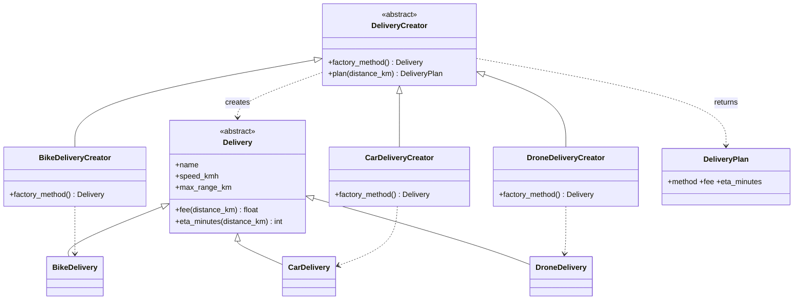
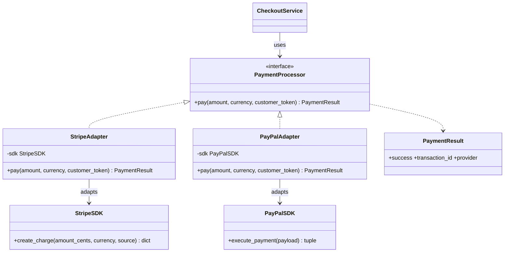
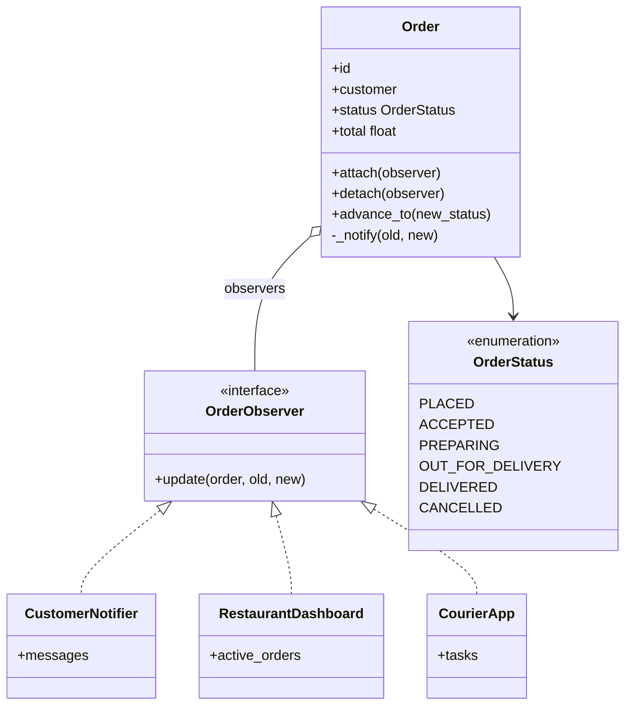

# Food Delivery App: Design Patterns

Core of a food delivery application (Python 3, standard library only) built around three design patterns.

| Category | Pattern | Where | Problem it solves |
|---|---|---|---|
| Creational | **Factory Method** | `fooddelivery/delivery.py` | Creating the right delivery type (bike, car, drone) without hard-coding concrete classes |
| Structural | **Adapter** | `fooddelivery/payments.py` | Using payment SDKs with incompatible APIs behind one interface |
| Behavioral | **Observer** | `fooddelivery/orders.py` | Telling customer, restaurant and courier about order status changes without coupling them to `Order` |

`fooddelivery/service.py` (`CheckoutService`) combines all three in one checkout flow.

## Run

```bash
python3 main.py                          # demo with Stripe and PayPal
python3 -m unittest discover -s tests -v # 11 tests
```

## Project structure

```
main.py                     demo
fooddelivery/
  models.py                 MenuItem
  payments.py               Adapter pattern
  delivery.py               Factory Method pattern
  orders.py                 Observer pattern
  service.py                CheckoutService (uses all three)
tests/test_patterns.py
```

## 1. Factory Method (creational)

### UML class diagram



### Problem it solves
Each delivery method has its own speed, range and pricing, and the right one depends on distance and whether the customer chose express. Order-processing code should not need to know any of those details, and adding a new method (e.g. electric scooter) should not mean editing that code.

### Design without the pattern
The checkout code would contain the branching and the construction itself:

```python
if express and distance <= 10:
    fee = 5.0 + distance; eta = distance / 60 * 60      # drone rules
elif distance <= 3:
    fee = 1.5 + 0.5 * distance; eta = distance / 15 * 60  # bike rules
else:
    fee = 3.0 + 0.8 * distance; eta = distance / 35 * 60  # car rules
```

Problems: pricing and ETA rules are mixed into checkout, the same `if/elif` chain gets copied wherever delivery is needed (tracking, refunds, reporting), and every new vehicle type requires editing all of those places, which risks bugs and breaks the Open/Closed Principle. Unit testing a single vehicle's rules would require running the whole checkout.

### With the pattern
`DeliveryCreator.plan()` holds the shared logic and calls `factory_method()` for the concrete `Delivery`. A new vehicle needs one new `Delivery` subclass, one new creator and one line in `select_creator()`. Nothing else changes.

## 2. Adapter (structural)

### UML class diagram



### Problem it solves
Stripe-style and PayPal-style SDKs have different method names, amount formats (integer cents vs. string decimals), request shapes (flat arguments vs. nested payloads) and responses (dict vs. tuple). We cannot modify third-party code, but the app needs to treat all providers the same way.

### Design without the pattern
`CheckoutService` would call each SDK directly:

```python
if provider == "stripe":
    r = stripe.create_charge(int(total * 100), "usd", token)
    ok = r["status"] == "succeeded"
elif provider == "paypal":
    ok, ref = paypal.execute_payment({... nested payload ...})
```

Problems: business logic is tied to vendor APIs, every provider adds another branch (and another copy in refunds, subscriptions, etc.), tests need a real or mocked version of each SDK, and a vendor API change forces edits in core code. Adding a provider means modifying checkout rather than extending the system.

### With the pattern
`CheckoutService` depends only on `PaymentProcessor`. Each adapter wraps one SDK and converts amounts, payloads and responses to the common `PaymentResult`. A new provider is one new adapter class, and `CheckoutService` is untouched. Switching provider is a constructor argument.

## 3. Observer (behavioral)

### UML class diagram



### Problem it solves
When an order changes status, several independent parties must react: the customer gets an SMS, the restaurant dashboard updates, the courier app creates a task. These parties differ, change often and may differ per order.

### Design without the pattern
`Order.advance_to()` would call every interested party directly:

```python
def advance_to(self, status):
    self.status = status
    sms_service.send(self.customer, ...)
    dashboard.refresh(self.id, status)
    if status == OUT_FOR_DELIVERY:
        courier_app.create_task(self.id)
```

Problems: `Order` is tightly coupled to every notification channel, so adding push notifications, analytics or an admin audit log means editing `Order`; it cannot be tested without all those services; and one failing service can break the status change. The alternative, having each party poll the order repeatedly, wastes resources and delays updates.

### With the pattern
`Order` only knows the `OrderObserver` interface. Observers subscribe with `attach()` and unsubscribe with `detach()`. Each decides for itself whether an update matters (`CourierApp` ignores most statuses). New listeners need no change to `Order`, and the state-transition rules stay in one place.

## How the patterns work together

```
CheckoutService.checkout(order, token, distance, express)
  1. select_creator(...).plan(...)        <- Factory Method picks delivery
  2. processor.pay(total, ...)            <- Adapter hides the payment SDK
  3. order.advance_to(ACCEPTED/CANCELLED) <- Observer notifies everyone
```

## Git workflow

The history is split by feature so each pattern can be reviewed on its own: `git log --oneline`.
